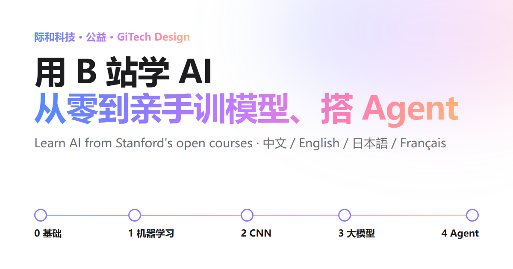

[中文](README.md) · **English** · [日本語](README.ja.md) · [Français](README.fr.md)

# Learn AI from Stanford's open courses: from zero to training models and building agents by hand

A free handbook for engineering graduates and PhDs with a solid technical background but no AI training. It lays out a five-stage route built on Stanford's open courses: what to fill in, which courses and lectures to watch or skip, and what you should build at each stage. By the end you can train models yourself and write your own agent and harness.

**Read it online:** [中文](https://www.gitechdesign.com/learn-ai/) · [English](https://www.gitechdesign.com/learn-ai/en/) · [日本語](https://www.gitechdesign.com/learn-ai/ja/) · [Français](https://www.gitechdesign.com/learn-ai/fr/)



## What's inside

- **Five stages plus electives:** 0 foundations → 1 machine learning (CS229) → 2 deep learning and CNNs (CS231n) → 3 large language models (Karpathy, CS336) → 4 agents and harnesses (Berkeley LLM Agents, Stanford CS329Z), with electives in reinforcement learning, graph learning, generative models, convex optimization and more. 25 courses in all.
- **Two video sources:** the Chinese edition defaults to Bilibili reposts with Chinese subtitles, the other editions to the official YouTube playlists; a switch at the top changes it at any time. Every course also has a search fallback, the course site, notes and assignments.
- **Hands-on milestones:** a small project and pass criteria for every stage. The four code blocks on the page are run by `test/snippets.py`, including a minimal agent of about sixty lines, standard library only, with a tool sandbox, write confirmation and a trace log.
- **Self-check:** seven questions that tell you which stage to start at.
- **Progress tracking:** ticks are kept in your own browser and never uploaded.
- **Four languages:** Chinese, English, Japanese and French, plus a four-language glossary of 26 terms.

## Deploy your own copy

You need Node.js 20 or newer, nothing else.

```sh
git clone https://github.com/lratusa/learn-ai-handbook.git
cd learn-ai-handbook
node build.mjs            # writes dist/: Chinese at the root, en/ ja/ fr/ below it
node tools/serve.mjs      # local preview at http://127.0.0.1:8080/
```

`dist/` is plain static files that work on any web server or static host.

**Under a sub-path or your own domain:** give the build its public address, and it generates the right asset paths, canonical and hreflang links and share cards.

```sh
SITE_URL=https://example.org/learn-ai node build.mjs            # macOS / Linux
$env:SITE_URL="https://example.org/learn-ai"; node build.mjs    # Windows PowerShell
```

Without `SITE_URL`, the pages assume the site root and leave out the SEO tags that need an absolute address. `BASE_PATH=/learn-ai/` changes only the path. Sites hosted in mainland China can show their ICP filing number in the footer with `ICP="…"`.

**GitHub Pages:** fork this repository → Settings → Pages → Build and deployment → Source: "GitHub Actions" → run "Deploy to GitHub Pages" from the Actions tab (it then updates on every push to main). The address is `https://<your-username>.github.io/learn-ai-handbook/`.

**nginx example** (copy `dist/` to `/var/www/learn-ai/`):

```nginx
location /learn-ai/ {
    alias /var/www/learn-ai/;
    index index.html;
}
```

Build it with `SITE_URL=https://your-domain/learn-ai`.

A self-hosted copy differs from the official edition in three places: the footer says it's a copy and links to the official edition; our ICP filing number is not shown; links to other pages of the GiTech site (the CS329A companion, the local-models report) become full URLs.

## Changing the content

| To change | Edit |
|---|---|
| Courses, video links, notes, assignments | `content/courses.mjs` |
| Text (the four languages mirror each other) | `content/i18n/zh.mjs`, `en.mjs`, `ja.mjs`, `fr.mjs` |
| Glossary | `content/glossary.mjs` |
| Code on the page | `snippets/*.py` |
| Styles, behaviour | `assets/style.css`, `assets/app.js` |

Then run the tests:

```sh
node --test test/handbook.test.mjs   # same structure in all languages, placeholders and anchors, link format, French punctuation, pages for three deployment setups
python test/snippets.py              # runs every code block on the page (needs numpy and PyTorch; CPU is fine)
```

Checking external links needs `npm install` and a local Chrome, Edge or Chromium (point `CHROME_PATH` at it if it isn't found):

```sh
node build.mjs && node tools/check-links.mjs   # HTTP status of course sites, YouTube, notes and other links
node tools/check-bili.mjs                      # opens each Bilibili video in a browser and reads title, uploader and part count
node tools/shoot.mjs                           # desktop and phone screenshots, exercising the self-check and progress tracker
```

Please check Bilibili links the way a reader would, one page at a time in a browser, not by bulk API scraping. Found a dead link or a course worth adding? Open an issue or a pull request, or write to raymond@gitechdesign.com.

## Layout

```
build.mjs              generator: content/ + assets/ + snippets/ → dist/
config/default.mjs     self-hosting defaults (reads SITE_URL, BASE_PATH, ICP)
config/gitechdesign.mjs  settings of the official edition at www.gitechdesign.com/learn-ai/
content/               course data, texts in four languages, glossary
assets/                styles, script, share image, icons
snippets/              the Python code shown on the page
test/                  page tests and code tests
tools/                 local preview, link checks, screenshots, live checks
```

## Licence

- Code: [MIT](LICENSE).
- Written content: [CC BY 4.0](LICENSE-CONTENT.md), attributed to "GiTech Design (际和科技)".
- The GiTech name and logo are not licensed. The courses, videos and materials the handbook links to belong to Stanford University and the universities, authors and channels named on each card; this project only indexes them and hosts no video.

Compiled by [GiTech Design](https://www.gitechdesign.com/en/). Free, no ads.
