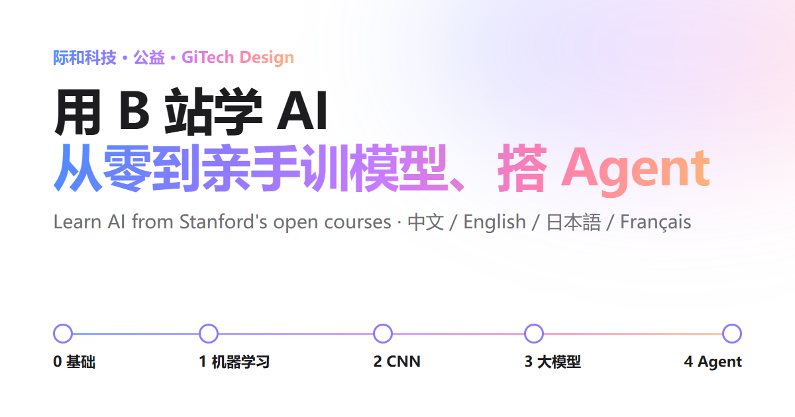

[中文](README.md) · [English](README.en.md) · **日本語** · [Français](README.fr.md)

# スタンフォードの公開講座で AI を学ぶ：ゼロから、自分でモデルを訓練し、エージェントを作るまで

しっかりした工学の素養はあるものの、AI を学んだことのない大学院生や博士のための無料ハンドブックです。スタンフォード大学の公開講座を軸に 5 つのステージのルートを組み、足りない基礎をどう補うか、どの講座のどの回を見るか（飛ばしてよいか）、各ステージで何を自分の手で作るかを示します。修了すれば、自分でモデルを訓練し、自分でエージェントとハーネスを書けるようになります。

**オンラインで読む：** [中文](https://www.gitechdesign.com/learn-ai/) · [English](https://www.gitechdesign.com/learn-ai/en/) · [日本語](https://www.gitechdesign.com/learn-ai/ja/) · [Français](https://www.gitechdesign.com/learn-ai/fr/)



## 内容

- **5 つのステージと選択科目：** 0 基礎 → 1 機械学習（CS229）→ 2 深層学習と CNN（CS231n）→ 3 大規模言語モデル（Karpathy、CS336）→ 4 エージェントとハーネス（バークレー LLM Agents、スタンフォード CS329Z）。強化学習、グラフ機械学習、生成モデル、凸最適化などの選択科目もあり、全部で 25 講座です。
- **2 つの動画ソース：** 中国語版は中国語字幕つきの Bilibili 転載、その他の言語版は YouTube 公式再生リストが既定で、ページ上部でいつでも切り替えられます。各講座には検索リンク、講座サイト、講義ノート、課題も付いています。
- **手を動かすマイルストーン：** ステージごとに小さなプロジェクトと合格基準があります。ページ上の 4 つのコードはすべて `test/snippets.py` で実際に実行しています。標準ライブラリだけで書いた 60 行ほどの最小エージェント（ツールのサンドボックス、書き込み前の確認、実行トレース付き）も含みます。
- **セルフチェック：** 7 つの質問で、どのステージから始めればよいかがわかります。
- **進捗管理：** チェックはあなたのブラウザ内にだけ保存され、送信されません。
- **4 言語：** 中国語、英語、日本語、フランス語。26 語の 4 言語用語集付き。

## 自分でデプロイする

必要なのは Node.js 20 以降だけで、ほかの依存はありません。

```sh
git clone https://github.com/lratusa/learn-ai-handbook.git
cd learn-ai-handbook
node build.mjs            # dist/ に出力：中国語版がルート、en/ ja/ fr/ がその下
node tools/serve.mjs      # ローカルプレビュー：http://127.0.0.1:8080/
```

`dist/` は純粋な静的ファイルなので、どんな Web サーバーや静的ホスティングでも動きます。

**サブパスや独自ドメインに置く場合：** ビルド時に公開アドレスを指定すると、正しいアセットのパス、canonical、hreflang、共有カードが生成されます。

```sh
SITE_URL=https://example.org/learn-ai node build.mjs            # macOS / Linux
$env:SITE_URL="https://example.org/learn-ai"; node build.mjs    # Windows PowerShell
```

`SITE_URL` を指定しない場合は、サイトのルートに置く前提でビルドし、絶対アドレスが必要な SEO タグは出力しません。パスだけを変えるなら `BASE_PATH=/learn-ai/` を使います。

**GitHub Pages：** このリポジトリをフォーク → Settings → Pages → Build and deployment → Source で「GitHub Actions」を選択 → Actions タブで「Deploy to GitHub Pages」を実行します（以後は main への push ごとに自動更新）。アドレスは `https://<ユーザー名>.github.io/learn-ai-handbook/` です。

**nginx の例**（`dist/` を `/var/www/learn-ai/` にコピー）：

```nginx
location /learn-ai/ {
    alias /var/www/learn-ai/;
    index index.html;
}
```

ビルド時は `SITE_URL=https://あなたのドメイン/learn-ai` を指定してください。

セルフホストしたコピーと公式版の違いは 3 点だけです。フッターにコピーである旨と公式版へのリンクが入ること、私たちの ICP 登録番号が表示されないこと、際和サイト内の他ページ（CS329A 学習ガイド、ローカルモデルの実測レポート）へのリンクが完全な URL になることです。

## 内容の修正と貢献

| 変えたいもの | 編集するファイル |
|---|---|
| 講座、動画リンク、講義ノート、課題 | `content/courses.mjs` |
| 文章（4 言語は 1 対 1 で対応） | `content/i18n/zh.mjs`、`en.mjs`、`ja.mjs`、`fr.mjs` |
| 用語集 | `content/glossary.mjs` |
| ページ上のコード | `snippets/*.py` |
| スタイル、動作 | `assets/style.css`、`assets/app.js` |

変更後はテストを実行します。

```sh
node --test test/handbook.test.mjs   # 4 言語の構造の一致、プレースホルダーとアンカー、リンク形式、フランス語の句読点、3 通りのデプロイ設定のページ
python test/snippets.py              # ページ上のコードをすべて実行（numpy と PyTorch が必要、CPU で可）
```

外部リンクの確認には `npm install` と、ローカルの Chrome、Edge、Chromium のいずれかが必要です（見つからない場合は `CHROME_PATH` で指定）。

```sh
node build.mjs && node tools/check-links.mjs   # 講座サイト、YouTube、講義ノートなどのリンクの HTTP ステータス
node tools/check-bili.mjs                      # Bilibili の動画を 1 本ずつブラウザで開き、タイトル、投稿者、話数を読む
node tools/shoot.mjs                           # デスクトップとスマートフォンのスクリーンショット（セルフチェックと進捗機能も動作確認）
```

Bilibili のリンクは、読者と同じようにブラウザで 1 ページずつ開いて確認してください。API による一括取得はしないでください。リンク切れや追加したい講座があれば、issue か pull request、または raymond@gitechdesign.com までお知らせください。

## ディレクトリ構成

```
build.mjs              ジェネレーター：content/ + assets/ + snippets/ → dist/
config/default.mjs     セルフホスト用の既定設定（SITE_URL、BASE_PATH、ICP を読む）
config/gitechdesign.mjs  公式版 www.gitechdesign.com/learn-ai/ の設定
content/               講座データ、4 言語の文章、用語集
assets/                スタイル、スクリプト、共有画像、アイコン
snippets/              ページに載せている Python コード
test/                  ページのテストとコードのテスト
tools/                 ローカルプレビュー、リンク確認、スクリーンショット、公開版の確認
```

## ライセンス

- コード：[MIT](LICENSE)。
- 文章：[CC BY 4.0](LICENSE-CONTENT.md)。クレジットは「GiTech Design（際和科技）」。
- 際和の名称とロゴはライセンスの対象外です。リンク先の講座、動画、資料の著作権は、スタンフォード大学および各カードに記載の大学、著者、チャンネルに帰属します。本プロジェクトはリンクを提供するだけで、動画はホストしていません。

[GiTech Design（際和科技）](https://www.gitechdesign.com/ja/)が編集。無料、広告なし。
