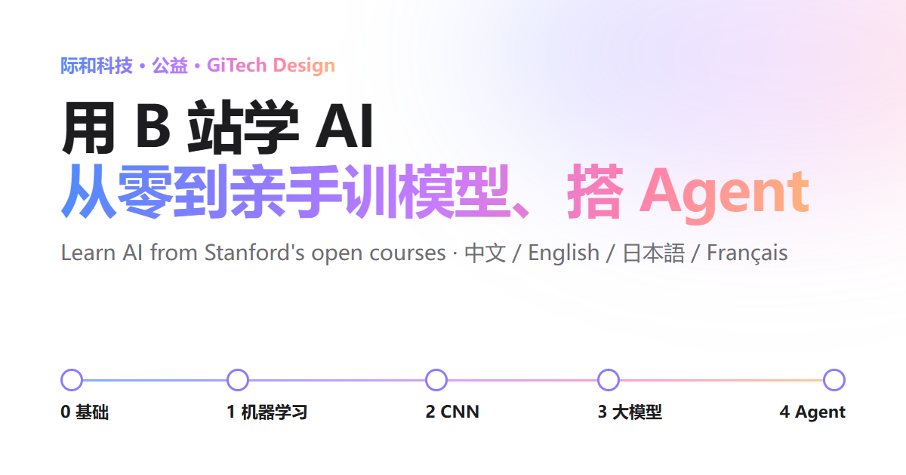

**中文** · [English](README.en.md) · [日本語](README.ja.md) · [Français](README.fr.md)

# 用 B 站学 AI：从零到亲手训模型、搭 Agent

一份免费的 AI 入门手册，写给有扎实工科底子、但没学过 AI 的研究生和博士。以斯坦福大学的公开课为主线，排出一条五站路线：缺什么补什么，看哪门课、哪几讲可以跳，每一站要亲手做出什么。学完能自己训练模型，自己写 agent 和 harness。

**在线阅读：** [中文](https://www.gitechdesign.com/learn-ai/) · [English](https://www.gitechdesign.com/learn-ai/en/) · [日本語](https://www.gitechdesign.com/learn-ai/ja/) · [Français](https://www.gitechdesign.com/learn-ai/fr/)



## 手册里有什么

- **五站路线加选修**：0 基础补课 → 1 机器学习（CS229）→ 2 深度学习与 CNN（CS231n）→ 3 大模型（Karpathy、CS336）→ 4 Agent 与 Harness（伯克利 LLM Agents、斯坦福 CS329Z），另有强化学习、图神经网络、生成模型、凸优化等选修方向。共 25 门课。
- **两套视频源**：中文版默认给 B 站的中文字幕转载，其他语言默认给 YouTube 官方播放列表，页面顶部可以随时切换。每门课都附有搜索备用链接、课程官网、讲义和作业。
- **动手里程碑**：每站一个要亲手完成的小项目和过关标准。页面上的 4 段代码都由 `test/snippets.py` 实际运行过，包括一个六十多行、只用标准库的最小 agent（带工具沙箱、写入确认和轨迹日志）。
- **开篇自测**：7 个问题，告诉你从第几站开始。
- **学习进度**：勾选记录保存在你自己的浏览器里，不上传。
- **四种语言**：中文、英文、日文、法文，外加 26 个术语的四语对照表。

## 自己部署

只需要 Node.js 20 或更新的版本，没有其他依赖。

```sh
git clone https://github.com/lratusa/learn-ai-handbook.git
cd learn-ai-handbook
node build.mjs            # 生成到 dist/：中文版在根目录，en/ ja/ fr/ 在子目录
node tools/serve.mjs      # 本地预览：http://127.0.0.1:8080/
```

`dist/` 是纯静态文件，放到任何网页服务器或静态托管上都能用。

**放在子路径或自己的域名下**：构建时告诉它对外地址，页面会据此生成正确的资源路径、canonical、hreflang 和分享卡片。

```sh
SITE_URL=https://example.org/learn-ai node build.mjs     # macOS / Linux
$env:SITE_URL="https://example.org/learn-ai"; node build.mjs   # Windows PowerShell
```

不设 `SITE_URL` 时，页面假定放在网站根目录，也不输出需要绝对地址的那几个 SEO 标签。只想换路径可以用 `BASE_PATH=/learn-ai/`。国内网站如有 ICP 备案号，可以用 `ICP="京ICP备……"` 显示在页尾。

**GitHub Pages**：Fork 本仓库 → Settings → Pages → Build and deployment → Source 选 “GitHub Actions” → 到 Actions 页面运行 “Deploy to GitHub Pages”（之后每次推送到 main 会自动更新）。地址是 `https://<你的用户名>.github.io/learn-ai-handbook/`。

**nginx 示例**（把 `dist/` 复制到 `/var/www/learn-ai/`）：

```nginx
location /learn-ai/ {
    alias /var/www/learn-ai/;
    index index.html;
}
```

构建时配合 `SITE_URL=https://你的域名/learn-ai`。

自己部署的副本和官方版本只有三处不同：页尾注明这是副本并链接到官方版本；不显示我们的备案号；指向际和网站其他页面的链接（CS329A 学习伴侣、本地模型实测）改成完整网址。

## 修改内容、参与贡献

| 想改什么 | 改哪个文件 |
|---|---|
| 课程、视频链接、讲义作业 | `content/courses.mjs` |
| 文案（四种语言一一对应） | `content/i18n/zh.mjs`、`en.mjs`、`ja.mjs`、`fr.mjs` |
| 术语表 | `content/glossary.mjs` |
| 页面上的代码 | `snippets/*.py` |
| 样式、交互 | `assets/style.css`、`assets/app.js` |

改完运行测试：

```sh
node --test test/handbook.test.mjs   # 四种语言结构一致、占位符和锚点齐全、链接格式、法语标点、三种部署方式的页面
python test/snippets.py              # 运行页面上的全部代码（需要 numpy 和 PyTorch，CPU 即可）
```

核对外部链接需要先 `npm install`，并且本机装有 Chrome、Edge 或 Chromium（找不到时用 `CHROME_PATH` 指定）：

```sh
node build.mjs && node tools/check-links.mjs   # 课程官网、YouTube、讲义等链接的 HTTP 状态
node tools/check-bili.mjs                      # 逐个在浏览器里打开 B 站视频，读标题、UP 主和集数
node tools/shoot.mjs                           # 桌面和手机截图，顺便测试自测和进度功能
```

B 站链接请像普通读者那样在浏览器里逐个打开核对，不要用接口批量抓取。发现失效链接或者想推荐课程，欢迎提 issue 或 pull request，也可以发邮件到 raymond@gitechdesign.com。

## 目录结构

```
build.mjs              生成器：content/ + assets/ + snippets/ → dist/
config/default.mjs     自部署的默认设置（读取 SITE_URL、BASE_PATH、ICP）
config/gitechdesign.mjs  官方版本 www.gitechdesign.com/learn-ai/ 的设置
content/               课程数据、四种语言文案、术语表
assets/                样式、脚本、分享图、图标
snippets/              页面上的 Python 代码
test/                  页面测试和代码测试
tools/                 本地预览、链接核对、截图、线上检查
```

## 许可

- 代码：[MIT](LICENSE)。
- 文字内容：[CC BY 4.0](LICENSE-CONTENT.md)，署名“际和科技（GiTech Design）”。
- 际和的名称和标志不在许可范围内。手册链接的课程、视频和资料，版权归斯坦福大学及卡片上注明的各校、作者和频道，本项目只提供索引，不托管任何视频。

由[际和科技](https://www.gitechdesign.com/zh/)整理，免费、无广告。
